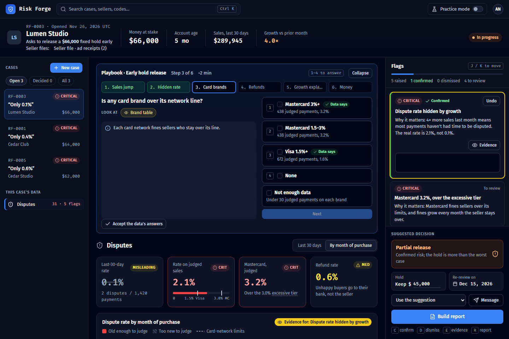
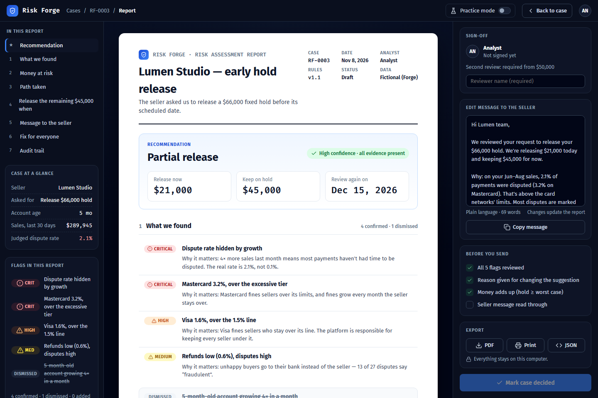

# Risk Forge

Risk Forge is an offline browser app for practising risk assessment on fictional seller cases: forge a case, review the evidence, flag the issues, and write the report. Everything stays on your computer.

**Try it:** https://ixmxamar.github.io/ultimate-risk-forge/ (no sign-up, nothing is sent anywhere). To run it locally, use `npm install` and then `npm run dev`.

**Status:** one case type is playable end to end, *Hidden by growth*: a seller asks to release a hold early while fast sales growth hides its real dispute rate. The Forge lists the other case types (forged statements, refund rings, card testing, sanctions screening and more) as coming soon.

## Scripts

- `npm run dev` starts the dev server.
- `npm test` runs the tests; `npm run typecheck` checks types; `npm run build` builds the static bundle.
- `npm run check:offline` builds and fails if the bundle refers to any remote address.
- `npm run qa:shots` builds and saves Chrome screenshots of the console (also with the playbook at its third step), report and Forge screens into `qa-shots/` (set `CHROME_PATH` if Chrome is elsewhere).

## Playbooks

Cases of the Hidden by growth type come with a playbook: six short questions (sales jump, hidden rate, card brands, refunds, growth explained, money) that walk you through the evidence. Each question has "Look at" chips that open the data it is about, and each answer confirms or dismisses the matching flags. The bar ends with a suggested decision you can use as is, and the report lists the path you took. No case suggests releasing a hold while a critical or high flag is still unreviewed; the decision panel asks you to review the flags first. Press 1–4 to pick an answer; a step that does not apply is skipped, and you can collapse the bar or reopen an earlier step.

In practice mode the bar shows no "Data says" marks, no Accept button and no conclusion until you mark the case decided; then it compares your path with the expected one.
